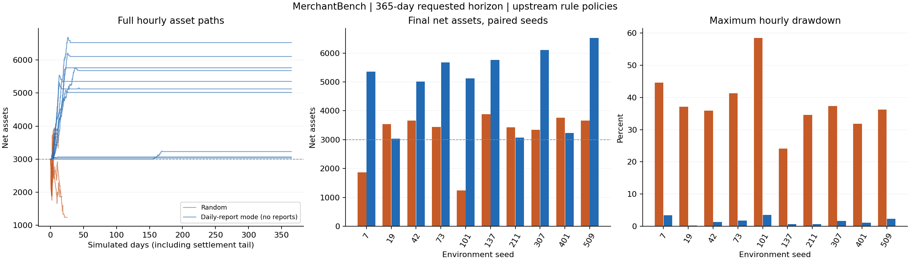

# 已执行验证：2026-10-08

这是公开合成数据上的真实运行结果，不是论文表格或预算推算。基提交为 `f44ce969aeccfd65d1eef6afe50f69868e510946`。
模拟器和原始规则策略在整批运行期间保持不变，独立分析扩展完成后对全部归档统一重算。当前版本没有实际运行任何LLM策略。

## 完成范围

- 1天冒烟：seed=42，两策略均完成，含结算尾期。
- 首轮365天：42、7、19，共6个任务完成。
- 正式365天：42、7、19、73、101、137、211、307、401、509，共20/20任务完成，执行失败0。
- 前3种子的两策略重复运行，全部指标序列逐点一致、死亡时间一致，见 `replay-check.json`。
- 相关测试最终为 **142 passed, 1 skipped**；另对最终分析/恢复逻辑复核10个测试全部通过。跳过项需要未公开的私有日报，因文件缺失跳过，不记作通过。
- 缺失日报的 `--require-reports` 检查已实测拒绝提交，未创建实验目录。
- 初始化阶段存在一次localhost跨命令隔离导致连接失败、一次工作区SQLite读取异常（database disk image is malformed）；这两次不纳入业务统计。将服务与采集器置于同一命令、数据库改至独立/tmp后未再复现，未把尚未定位的故障归因为确定的模拟器缺陷。

## 主要结果

初始净资产3000。数值按同策略10个种子汇总，回撤为先计算每次运行的逐时最大回撤、再跨种子求平均。

| 指标 | random | daily_report（无日报，过滤回退） |
|---|---:|---:|
| 最终净资产均值 | 3183.52 | 4890.87 |
| 最终净资产样本标准差 | 885.88 | 1305.61 |
| 净利润均值 | 181.84 | 1890.87 |
| 店铺评分均值（1–5） | 3.1012 | 3.9982 |
| 平均最大回撤 | 38.19% | 1.67% |
| 有货且存活时段占全年比例 | 1.26% | 4.51% |
| 存活至最终结算 | 0/10 | 10/10 |
| 存活率Wilson 95%区间 | 0%–27.75% | 72.25%–100% |

配对净资产差值（daily_report−random）均值 **1707.35**，固定重采样种子的bootstrap 95%均值区间 **[690.89, 2692.03]**；7/10个种子为正。这是小样本、固定合成场景的初评，不是普适胜率或现实投资收益保证。

随机策略全部在t=34–468永久关店，之后仍完成在途订单结算。因此某些死店最终净资产仍高于3000：活着与结算后的资产排名是两件不同的事。日报回退策略全部存活，但全部年末在售数为0，平均有货时段约16.45天；过滤条件严格和不重复上架机制限制了候选池。约4分的最终店铺评分还受到先验/时间衰减影响，不能视为整年持续优质履约的证明。

**默认实验没有任何真实商机日报（0/365天）。** 两组还同时存在现金保护、滞销清理、质量/价格过滤差异；结果不能被解释为“日报选品因果提升收益”。

| 种子 | random净资产 | 日报回退净资产 | 配对差值 | random最大回撤 | 日报回退最大回撤 |
|---|---:|---:|---:|---:|---:|
| 7 | 1866.25 | 5353.07 | +3486.82 | 44.64% | 3.37% |
| 19 | 3537.64 | 3035.64 | -502.00 | 37.16% | 0.17% |
| 42 | 3657.99 | 5019.13 | +1361.14 | 35.97% | 1.31% |
| 73 | 3441.78 | 5679.96 | +2238.18 | 41.36% | 1.79% |
| 101 | 1244.37 | 5125.12 | +3880.75 | 58.52% | 3.57% |
| 137 | 3885.98 | 5764.44 | +1878.46 | 24.17% | 0.71% |
| 211 | 3423.49 | 3067.80 | -355.69 | 34.60% | 0.66% |
| 307 | 3344.24 | 6105.33 | +2761.09 | 37.36% | 1.68% |
| 401 | 3765.54 | 3231.36 | -534.18 | 31.89% | 1.11% |
| 509 | 3667.92 | 6526.83 | +2858.91 | 36.24% | 2.31% |



## 实测资源

- 20任务串行总耗时 **498.7秒（8.31分钟）**；随机组单次均值3.98秒（全部提前死亡），日报回退组单次均值45.22秒（跑满8760步）。
- 运行数据库/快照合计 **1.37GiB，98,700个文件**，不含软件依赖。初始20任务内存采样因PID命名空间映射而失效，归档以null标记，不宣称测到了整批峰值。
- 修正采样器后单独复跑seed=42两策略，约52.3秒，采样进程树RSS峰值 **244.5MiB**；包括启动器、服务端、采集器和agent，共享页可能重复计数，0.5秒采样也可能漏过瞬时峰值。此数是两任务探测值，不是20任务峰值。
- 普通CPU串行即可；无需GPU、无需LLM API密钥，本次LLM API调用为0。建议先用2GiB可用内存、至少5GiB本机空闲磁盘起步并监控，这只是余量建议，不是硬件保证。活跃订单更多的策略可能明显更慢、更占资源，不能照搬本次空货架策略的耗时预测。
- Python3.12环境，精确依赖见requirements.lock；绘图用独立Python环境matplotlib3.10.8，不参与仿真或评分。

## 证据与离线复核

`experiments/long_horizon/validation/` 保存逐种子CSV、完整汇总、运行manifest（含源代码和日报哈希）、资源记录、复跑核对、图表。随交付单独提供的 `merchantbench-results.tar.gz` 只含这批公开合成运行的merchant归档与元数据，不含私有日报、密钥、大型SQLite/逐步快照或服务器日志。先下载结果包到仓库根目录；未取得结果包时，也可按评估指南自行运行并生成同格式结果。

```bash
mkdir -p runs/archived-validation
tar -xzf merchantbench-results.tar.gz -C runs/archived-validation
.venv/bin/python scripts/analyze_long_horizon.py runs/archived-validation
# 可选：安装matplotlib后绘制全部逐时点
.venv/bin/python scripts/plot_long_horizon.py runs/archived-validation
```

复算会按当前分析器版本更新summary中的analyzer_sha256；运行manifest保留原始指纹。原始官方评分函数未修改。完整操作和LLM扩展约束见[评估方案](long_horizon_evaluation.md)。
